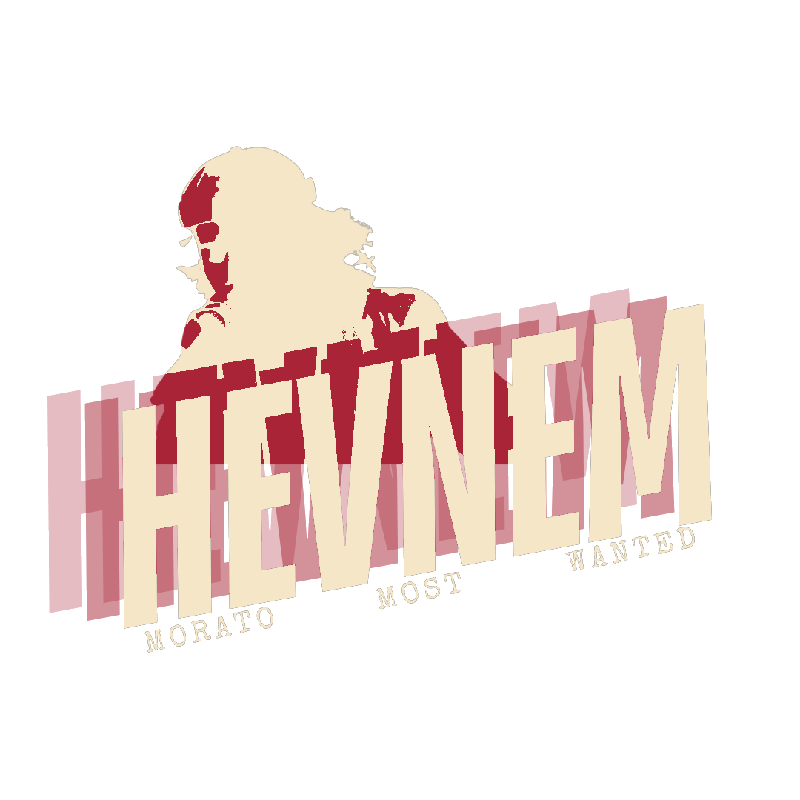

<div align="center">

  

  # Hevnem

  <p><strong>A personal web audio sanctuary tailored for streaming and exploring the discography of Hev Abi.</strong></p>

  <p>
    <a href="https://hevnem.vercel.app"></a>
    
    
    
  </p>

</div>

---

## Overview

**Hevnem** is a personal web audio experience crafted to celebrate the music, storytelling, and discography of Filipino hip-hop artist **Hev Abi**. 

Conceived not as a conventional music streamer, but as an intimate digital vinyl listening lounge, Hevnem pairs modern web performance with rich, atmospheric visual craftsmanship. From ambient album gradients that gently shift as music plays to smooth audio crossfading between tracks, every detail is engineered to make exploring Hev Abi's catalog an immersive journey.

---

## Architectural Highlights

```
                       ┌────────────────────────────────┐
                       │        Player Shell            │
                       │ (hevnem-layout / Ambient Glow) │
                       └───────────────┬────────────────┘
                                       │
            ┌──────────────────────────┴──────────────────────────┐
            ▼                                                     ▼
┌───────────────────────┐                             ┌───────────────────────┐
│     Stage Deck        │                             │     Playback Dock     │
│  • Hero Artwork       │ ◄─────── Signals ─────────► │  • Dual-Deck Engine   │
│  • 3D Artwork Flip    │                             │  • Scrubbing & Volume │
│  • Responsive Drawers │                             │  • Shuffle & Repeat   │
└───────────────────────┘                             └───────────────────────┘
            │                                                     │
            ▼                                                     ▼
┌───────────────────────┐                             ┌───────────────────────┐
│   Tab Session Hub     │                             │   "Walang Makapa"     │
│  • Multi-Tab Sync     │                             │  • Isolated 404 Room  │
│  • Single-Play Lock   │                             │  • Interactive Vinyl  │
└───────────────────────┘                             └───────────────────────┘
```

### 1. Dual-Deck Audio Crossfading Engine
A custom Web Audio controller orchestrates two independent HTML5 playback channels simultaneously. As a track approaches its conclusion, the engine preloads the upcoming track on the idle deck, automatically fading out the active deck while fading in the next track with frame-accurate attenuation.

### 2. Ambient Chromatics & Dual-Plane Crossfader
Album art colors dynamically bathe the entire viewport. Background color transitions utilize a dual-plane opacity crossfader that smoothly shifts gradients between albums (*Pautang ng Pag-ibig*, *Sakred Boy*, *Kung Alam Mo Lang*, *Bahay Namin Maliit Lamang*, etc.) without layout thrashing.

### 3. Multi-Tab Session Synchronization
Using a zero-overhead `BroadcastChannel` protocol paired with `localStorage`, Hevnem coordinates playback presence across multiple browser tabs. Opening a second tab suppresses redundant intro overtures and ensures playback remains coherent.

### 4. Interactive "Walang Makapa" 404 Experience
Visiting an invalid route uncovers a custom not-found stage: an interactive grooved vinyl turntable spinning *Walang Makapa*, backed by the deep emerald green *Sakred Boy* palette, an on-screen audio scrubber, and bilingual commentary (Filipino & English) for lost listeners.

### 5. Mobile Stage Containment
Engineered with mobile-first viewport lock and touch physics. Side panels gracefully transform into fluid bottom-sheet drawers on small screens, preserving uninterrupted audio playback and tactile control.

---

## Tech Stack

- **Framework**: [Angular v21](https://angular.dev/) (Signals, Standalone Components, SSR Hydration)
- **Styling**: [Tailwind CSS v4](https://tailwindcss.com/) with custom design tokens (`Bodoni Moda` serif, `Harmattan` display, and dynamic album palette variables)
- **Cinematics**: [GSAP](https://greensock.com/gsap/) for orchestrated intro sequences and stage transitions
- **Audio Architecture**: Custom dual-channel HTML5 audio driver with lookahead preloading and deterministic queue sequencing
- **Content Delivery**: Optimized, high-fidelity distributed audio streaming
- **Hosting**: [Vercel](https://vercel.com/) with edge deployment

---

## Project Structure

```
Hevnem/
├── docs/
│   └── adr/                 # Architecture Decision Records (ADRs)
├── GLOSSARY.md              # Project domain language & canonical terms
├── client/
│   ├── public/
│   │   ├── brand/           # Unified emblems, logos & favicons
│   │   ├── assets/          # SVG iconography & album artwork
│   │   ├── robots.txt       # Crawler access policy
│   │   └── sitemap.xml      # Canonical sitemap
│   └── src/
│       ├── app/
│       │   ├── data/        # In-memory song catalog & metadata
│       │   ├── helpers/     # Crossfade engine & tab session coordinator
│       │   ├── layouts/     # Hevnem player shell & ambient background
│       │   ├── models/      # Domain interfaces & types
│       │   ├── pages/       # Standalone route views (NotFound / 404)
│       │   ├── sections/    # Modular UI blocks (Intro, Stage, Dock, Drawers)
│       │   └── services/    # Audio player, catalog & layout state services
│       └── styles.css       # Design tokens & album color palettes
└── README.md
```

---

## Getting Started

### Prerequisites

- [Node.js](https://nodejs.org/) v20.x or higher
- [npm](https://www.npmjs.com/) v10.x or higher

### Installation & Local Setup

1. **Clone the repository**:
   ```bash
   git clone https://github.com/your-username/Hevnem.git
   cd Hevnem/client
   ```

2. **Install dependencies**:
   ```bash
   npm install
   ```

3. **Start the development server**:
   ```bash
   npm run start
   ```

4. **Launch the player**:
   Open [http://localhost:4200](http://localhost:4200) in your browser.

---

## Design System & Typography

- **Display Typography**: `Bodoni Moda` — editorial serif tailored for track titles, numerals, and hero headings.
- **Interface Typography**: `Harmattan` & System UI — clean, legible sans-serif for track metadata, timecodes, and controls.
- **Brand Palette**:
  - Ink Primary: `#FBF7EF`
  - Hevnem Cream: `#F5E6C8`
  - Hevnem On-Cream: `#1A1410`
  - Deep Stage Dark: `#070B0E`
  - Album Accents: Dynamically bound per project (*Pautang ng Pag-ibig Crimson*, *Sakred Boy Forest Green*, *Maduming Timog Amber*, etc.)

---

## Personal Note & Credits

> *Hevnem* is an independent, non-commercial fan project built out of pure appreciation for the discography and artistic vision of **Hev Abi**.
>
> All musical compositions, audio recordings, project titles, and album artworks remain the intellectual property of **Hev Abi**, **Downtown Q Entertainment**, and their respective rights holders.

---

<div align="center">
  <sub>Crafted with passion for sound and web craftsmanship.</sub>
</div>

